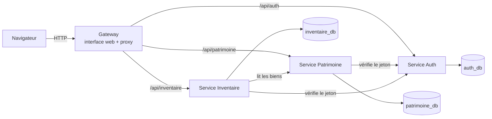

<p align="center">
  
</p>

<h1 align="center">Patrimmo</h1>
<p align="center"><b>Plateforme de gestion du patrimoine immobilier de l’État</b></p>

<p align="center">
  Laravel 12 · PostgreSQL 16 · Docker · Architecture microservices
</p>

---

## Sommaire

1. [Présentation](#1-présentation)
2. [Fonctionnalités](#2-fonctionnalités)
3. [Architecture](#3-architecture)
4. [Technologies](#4-technologies)
5. [Structure du dépôt](#5-structure-du-dépôt)
6. [Rôles et permissions](#6-rôles-et-permissions)
7. [Installation](#7-installation)
8. [Variables d’environnement](#8-variables-denvironnement)
9. [Utilisation](#9-utilisation)
10. [Documentation de l’API](#10-documentation-de-lapi)
11. [Modèle de données](#11-modèle-de-données)
12. [Conception et maquettes](#12-conception-et-maquettes)
13. [Déploiement](#13-déploiement)
14. [Sécurité](#14-sécurité)
15. [Limites et évolutions](#15-limites-et-évolutions)
16. [Auteure](#16-auteure)

---

## 1. Présentation

**Patrimmo** remplace les registres papier utilisés pour suivre le patrimoine immobilier de l’État (bâtiments administratifs, logements de fonction, entrepôts, locaux techniques) par une application web centralisée.

**Problèmes résolus :**

- risque de perte, de dégradation ou de falsification des registres ;
- inventaires longs et rarement à jour ;
- faible traçabilité des affectations et des transferts ;
- absence de vision globale de l’état du patrimoine ;
- difficulté à produire des états pour les contrôles.

**Périmètre de la version 1 :** le patrimoine **immobilier** uniquement. Le mobilier, le matériel et les terrains non bâtis sont hors périmètre ; l’architecture permet de les ajouter plus tard sans refonte.

> Projet individuel réalisé du 10 au 15 novembre 2026 dans le cadre de la formation en développement web de l’ADN GOLFE1 (Académie Digitale Numérique, Lomé, Togo).

## 2. Fonctionnalités

| Module | Fonctionnalités |
|---|---|
| **Biens immobiliers** | Enregistrement, modification, recherche (code, désignation), filtres (type, état), fiche détaillée, archivage. Code d’inventaire automatique `IMM-0001`. |
| **Affectations et transferts** | Demande d’affectation, de transfert ou de sortie du patrimoine, avec **validation** par la Direction ou l’administrateur. Historique complet des mouvements. |
| **Inventaires** | Lancement d’une campagne, constat par bien (présent, dégradé, introuvable), calcul automatique du résultat (conforme, à vérifier, écart), avancement en %, clôture. |
| **Maintenance** | Déclaration d’incidents et de travaux, prestataire, coût, suivi du statut. |
| **Rapports** | Inventaire immobilier, biens par service, biens à réhabiliter. Aperçu à l’écran et export **CSV** (ouvrable dans Excel). |
| **Tableau de bord** | Nombre de biens, superficie totale, biens à réhabiliter, répartition par type, derniers mouvements. |
| **Utilisateurs** | Création et gestion des comptes et des rôles (administrateur). |
| **Traçabilité** | Aucun bien n’est supprimé : il est archivé. Chaque mouvement enregistre qui l’a demandé et qui l’a validé. |

## 3. Architecture

L’application suit une **architecture en microservices**. Chaque service est un projet Laravel indépendant, avec sa **propre base de données** PostgreSQL. Une **passerelle** (API Gateway) est le point d’entrée unique et sert l’interface web.



| Service | Port local | Responsabilité | Base |
|---|---|---|---|
| **gateway** | 8000 (Docker : 8080) | Interface web, passerelle vers les services | `gateway_db` |
| **auth-service** | 8001 | Connexion, jetons, comptes, rôles | `auth_db` |
| **patrimoine-service** | 8002 | Biens, services, mouvements, maintenance, statistiques | `patrimoine_db` |
| **inventaire-service** | 8003 | Campagnes d’inventaire, constats, rapports | `inventaire_db` |
| **postgres** | 5432 | Une seule instance PostgreSQL, quatre bases | – |

**Authentification :** le service Auth émet un jeton (Laravel Sanctum). Les autres services vérifient ce jeton en appelant `GET /api/me` sur le service Auth, puis contrôlent le rôle de l’utilisateur.

## 4. Technologies

- **Back-end :** PHP 8.2, Laravel 12, Laravel Sanctum
- **Base de données :** PostgreSQL 16 (SQLite pour le développement local sans Docker)
- **Conteneurisation :** Docker, Docker Compose
- **Front-end :** HTML, CSS et JavaScript natif (page unique servie par la passerelle)
- **Conception :** UML, Figma
- **Versionnement :** Git et GitHub

## 5. Structure du dépôt

```
Gestion_de_patrimoine/
├── docker-compose.yml          # Orchestration des conteneurs (PostgreSQL inclus)
├── .env.example                # Modèle de configuration
├── db/init/
│   └── 01-create-databases.sh  # Crée une base par microservice
├── gateway/                    # Passerelle + interface web (public/app.html)
├── services/
│   ├── auth-service/           # Authentification et comptes
│   ├── patrimoine-service/     # Biens, mouvements, maintenance
│   └── inventaire-service/     # Inventaires et rapports
└── docs/                       # UML, fiche technique, guide d’utilisation
```

## 6. Rôles et permissions

| Action | Admin | Gestionnaire | Responsable | Contrôleur | Direction |
|---|:-:|:-:|:-:|:-:|:-:|
| Consulter biens, inventaires, rapports | ✅ | ✅ | ✅ | ✅ | ✅ |
| Créer, modifier, archiver un bien | ✅ | ✅ | | | |
| Demander une affectation / un transfert / une sortie | ✅ | ✅ | ✅ | | |
| **Valider ou refuser** une demande | ✅ | | | | ✅ |
| Déclarer et suivre la maintenance | ✅ | ✅ | | | |
| Lancer et clôturer un inventaire | ✅ | ✅ | | | |
| Enregistrer un constat d’inventaire | ✅ | ✅ | | ✅ | |
| Gérer les comptes utilisateurs | ✅ | | | | |

## 7. Installation

### Prérequis

- Git
- **Avec Docker :** Docker Desktop (ou Docker Engine + Docker Compose)
- **Sans Docker :** PHP 8.2 ou plus, Composer

### Option A : avec Docker (recommandé)

```bash
git clone https://github.com/kakpovidela0509-cyber/Gestion_de_patrimoine.git
cd Gestion_de_patrimoine

# 1. Configuration
cp .env.example .env
#    Ouvrir .env et renseigner DB_PASSWORD, JWT_SECRET et APP_KEY
#    (APP_KEY : exécuter « php artisan key:generate --show » dans un projet Laravel,
#     ou utiliser une chaîne de la forme base64:xxxxxxxx…)

# 2. Construction et démarrage
docker compose up -d --build

# 3. Vérification
docker compose ps
```

L’application est accessible sur **http://localhost:8080**.
Au démarrage, chaque service applique ses migrations ; le service Auth crée le compte administrateur et le service Patrimoine crée les services de l’administration.

Arrêt : `docker compose down` (ajouter `-v` pour supprimer aussi les données).

### Option B : sans Docker (développement)

Ouvrir **4 terminaux**, un par service, après avoir installé les dépendances dans chacun (`composer install`, puis copier `.env.example` en `.env` et `php artisan key:generate`).

```bash
# Terminal 1 : Auth
cd services/auth-service
php artisan migrate --seed
php artisan serve --port=8001

# Terminal 2 : Patrimoine
cd services/patrimoine-service
php artisan migrate --seed
php artisan serve --port=8002

# Terminal 3 : Inventaire
cd services/inventaire-service
php artisan migrate
php artisan serve --port=8003

# Terminal 4 : Passerelle et interface
cd gateway
php artisan serve --port=8000
```

Ouvrir **http://localhost:8000**.

### Compte de démonstration

| E-mail | Mot de passe | Rôle |
|---|---|---|
| `admin@patrimoine.tg` | `Admin@2026` | Administrateur |

> ⚠️ Changer ce mot de passe avant toute mise en production. Créer ensuite les autres comptes (gestionnaire, responsable, contrôleur, direction) depuis la page **Utilisateurs**.

## 8. Variables d’environnement

Fichier `.env` à la racine (jamais versionné) :

| Variable | Rôle | Exemple |
|---|---|---|
| `APP_ENV` | Environnement | `local` |
| `APP_DEBUG` | Affichage détaillé des erreurs | `true` (mettre `false` en production) |
| `APP_KEY` | Clé de chiffrement Laravel | `base64:…` |
| `DB_USER` | Utilisateur PostgreSQL | `patrimoine` |
| `DB_PASSWORD` | Mot de passe PostgreSQL | à définir |
| `JWT_SECRET` | Secret partagé | à définir |

Adresses entre services (définies dans `docker-compose.yml`) : `AUTH_SERVICE_URL`, `PATRIMOINE_SERVICE_URL`, `INVENTAIRE_SERVICE_URL`.

## 9. Utilisation

1. **Se connecter** avec un compte.
2. **Biens immobiliers :** « Nouveau bien » pour enregistrer un bâtiment ; cliquer sur une ligne pour ouvrir sa fiche.
3. **Affecter ou transférer :** depuis la fiche d’un bien ou la page **Affectations**, soumettre une demande. La Direction ou l’administrateur la **valide** ou la **refuse** ; le service du bien est alors mis à jour.
4. **Inventaire :** « Lancer une campagne », puis « Enregistrer un constat » pour chaque bien ; clôturer quand la campagne est terminée.
5. **Maintenance :** « Déclarer un incident » puis « Terminer » une fois les travaux faits.
6. **Rapports :** consulter l’aperçu ou télécharger le fichier Excel (CSV).

Un guide d’utilisation détaillé est disponible dans le dossier [`docs/`](docs/).

## 10. Documentation de l’API

Toutes les routes passent par la passerelle : `/api/{auth|patrimoine|inventaire}/…`. Les routes protégées demandent l’en-tête `Authorization: Bearer <jeton>`.

### Auth (`/api/auth`)

| Méthode | Route | Rôle requis | Description |
|---|---|---|---|
| POST | `/login` | public | Connexion, renvoie un jeton |
| GET | `/me` | connecté | Utilisateur courant |
| POST | `/logout` | connecté | Déconnexion |
| GET, POST | `/users` | admin | Lister, créer un compte |
| PUT, DELETE | `/users/{id}` | admin | Modifier, supprimer un compte |

### Patrimoine (`/api/patrimoine`)

| Méthode | Route | Rôle requis | Description |
|---|---|---|---|
| GET | `/biens` | connecté | Liste paginée (`q`, `type`, `etat`, `service_id`, `page`, `per_page`) |
| GET | `/biens/{id}` | connecté | Fiche, historique, maintenance |
| POST, PUT, DELETE | `/biens`, `/biens/{id}` | admin, gestionnaire | Créer, modifier, archiver |
| GET | `/services` | connecté | Services de l’administration |
| GET | `/stats` | connecté | Chiffres du tableau de bord |
| GET | `/mouvements` | connecté | Liste (`statut`) |
| POST | `/mouvements` | admin, gestionnaire, responsable | Demande d’affectation, transfert ou sortie |
| POST | `/mouvements/{id}/valider`, `/refuser` | admin, direction | Traiter une demande |
| GET | `/maintenances` | connecté | Liste |
| POST, PUT | `/maintenances`, `/maintenances/{id}` | admin, gestionnaire | Déclarer, mettre à jour |

### Inventaire (`/api/inventaire`)

| Méthode | Route | Rôle requis | Description |
|---|---|---|---|
| GET | `/inventaires`, `/inventaires/{id}` | connecté | Campagnes, détail et avancement |
| POST | `/inventaires` | admin, gestionnaire | Lancer une campagne |
| POST | `/inventaires/{id}/lignes` | admin, gestionnaire, contrôleur | Enregistrer un constat |
| POST | `/inventaires/{id}/cloturer` | admin, gestionnaire | Clôturer |
| GET | `/rapports/{type}?format=csv` | connecté | `inventaire-general`, `biens-par-service`, `a-rehabiliter` |

**Exemple de connexion :**

```bash
curl -X POST http://localhost:8000/api/auth/login \
  -H "Content-Type: application/json" -H "Accept: application/json" \
  -d '{"email":"admin@patrimoine.tg","password":"Admin@2026"}'
```

## 11. Modèle de données

| Service | Tables principales |
|---|---|
| **Auth** | `users` (nom, e-mail, mot de passe haché, rôle), `personal_access_tokens` |
| **Patrimoine** | `services`, `biens` (code, désignation, type, adresse, superficie, date d’acquisition, valeur, titre de propriété, état, statut, service), `mouvements` (type, origine, destination, motif, statut, demandeur, validateur), `maintenances` |
| **Inventaire** | `inventaires` (libellé, année, statut), `inventaire_lignes` (bien, constat, résultat, commentaire) |

Les services ne partagent aucune table : ils échangent uniquement par API.

## 12. Conception et maquettes

- **Maquettes Figma :** https://www.figma.com/design/uXFjSJh3DLnkN0OKSm7gfL
- **Diagrammes UML** (cas d’utilisation, classes, séquence, activités, états, composants et déploiement) : dossier [`docs/`](docs/)
- **Fiche technique, proposition financière et guide d’utilisation :** dossier [`docs/`](docs/)

## 13. Déploiement

**Plateforme hébergée :** `[À COMPLÉTER : adresse de la plateforme en ligne]`

Les `Dockerfile` de chaque service et le fichier `docker-compose.yml` permettent de déployer l’ensemble sur tout hébergeur compatible Docker. Pour la production : définir `APP_DEBUG=false`, changer tous les mots de passe et secrets, et placer l’application derrière HTTPS.

## 14. Sécurité

- Mots de passe hachés (bcrypt) et jetons d’accès Sanctum.
- Contrôle d’accès par rôle sur chaque route sensible.
- Validation de toutes les données reçues côté serveur.
- Échappement du contenu affiché dans l’interface (protection contre l’injection de HTML).
- Secrets conservés dans `.env`, exclu du dépôt par `.gitignore`.
- Aucune suppression définitive des biens : archivage et historique.

## 15. Limites et évolutions

**Limites de la version 1 :**

- les exports sont au format CSV (pas de PDF) ;
- pas de gestion des pièces jointes (photos, actes) ;
- pas de journal d’audit consultable à l’écran (les mouvements sont toutefois historisés) ;
- pas de tests automatisés complets.

**Évolutions envisagées :** patrimoine mobilier et matériel, terrains non bâtis, export PDF, pièces jointes, notifications, calcul d’amortissement, cartographie des biens, journal d’audit, application mobile pour les inventaires sur le terrain.

## 16. Auteure

**KAKPOVI Dela Nadia** : Intégratrice web, étudiante en développement web à l’ADN GOLFE1 (Académie Digitale Numérique), Lomé, Togo.

Formateurs : A. Gbadamassi et L. Togba.
